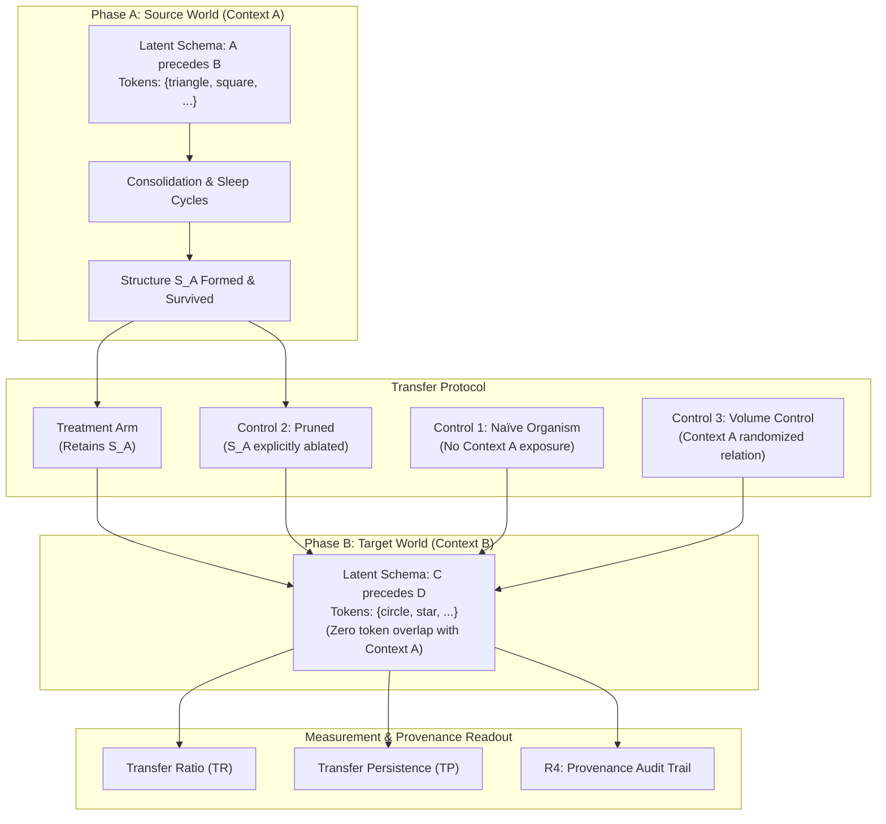

# Preregistration: Cross-Context Structural Reuse Experiment

**Title**: Can a developmental structure formed in one environment accelerate acquisition in a different environment without being relearned?  
**Status**: PREREGISTERED, PENDING EXECUTION  
**Date**: 2026-11-04  
**Authors**: Project Organica Research Group  

---

## 1. Scientific Objective

Project Organica has demonstrated that developmental cognitive structure accumulates monotonically across scales without dilution collapse (H24 confirmed: inventory $117 \to 190 \to 516$), and that active intervention accelerates cumulative inventory (+120.9%, $129 \to 285$) while unlocking higher-order theories and questions.

The foundational question is no longer whether structures form or survive, but whether accumulated structures constitute **reusable knowledge** or mere **environmental sediment**.

This experiment tests whether a developmental structure formed in Context A accelerates learning of an isomorphic relational structure in Context B without being relearned.

---

## 2. Operational Criteria for Reusable Knowledge

A developmental structure is defined as **reusable knowledge** if and only if all five conditions hold:

- **R1 — Observed Formation**: The structure $S_A$ is developmentally generated and consolidated in Context A, with its complete formation lineage recorded.
- **R2 — No Direct Reteaching**: Context B presents entirely novel surface vocabulary (zero token overlap with Context A). Context B never directly presents the specific instance learned in Context A.
- **R3 — Accelerated Acquisition (TR > 1)**: Acquisition of the target relation in Context B occurs faster in the presence of $S_A$ than in a naïve organism:
  $$\text{Transfer Ratio (TR)} = \frac{\text{cycles\_to\_acquire}_{\text{baseline}}}{\text{cycles\_to\_acquire}_{\text{transfer}}} > 1.0$$
- **R4 — Traceable Provenance**: The observer instrument identifies $S_A$ as an active participant (via parentage, condition, or hypothesis prior) in the acquisition of Context B structure.
- **R5 — Transfer Persistence (TP)**: The transferred structure (or its direct abstraction descendant) survives ongoing sleep-cycle natural selection in Context B for at least $N_{\text{persist}} = 20$ cycles, proving it becomes part of the organism rather than a transient activation artifact.

---

## 3. Experimental Architecture

---

## 4. Experimental Arms & Controls

1. **Treatment Arm (Pre-trained)**:
   - Trained in Context A on relational schema $X \prec Y$.
   - Enters Context B ($W \prec Z$) with intact consolidated memory.
2. **Control 1 (Naïve Baseline)**:
   - Fresh organism initialized with empty memory.
   - Measures raw baseline cycles to acquire the target schema in Context B.
3. **Control 2 (Structural Ablation / Pruned)**:
   - Trained in Context A; immediately prior to Context B, structure $S_A$ is selectively excised from memory while leaving background event history intact.
   - Demonstrates that speedup is causally driven by structure $S_A$, not general memory volume.
4. **Control 3 (Orthogonal Schema Control)**:
   - Trained in Context A on an unrelated/orthogonal relational schema.
   - Controls for general exposure, event count, and generic familiarity.

---

## 5. Primary Endpoints & Verdict Mapping

| Outcome | Criteria | Interpretation |
|---|---|---|
| **Reusable Knowledge Demonstrated** | R1–R5 all satisfied; $\text{TR} > 1.25$ ($p < 0.01$ across 10 seeds); $\text{TP} \ge 20$ | **Developmental structure accelerates novel acquisition and integrates into ongoing cognitive apparatus.** |
| **Transient Transfer** | R1–R4 satisfied, but R5 fails ($\text{TP} < 5$) | Immediate acceleration occurs, but structure decays rapidly; fails long-term integration. |
| **Null Transfer (Ballast)** | $\text{TR} \approx 1.0$ ($0.95 \le \text{TR} \le 1.05$) | Structures accumulate but do not perform cross-context cognitive work (environmental sediment). |
| **Negative Interference** | $\text{TR} < 0.90$ ($p < 0.05$) | Prior structure hinders novel acquisition (overfitting/rigidity). |
