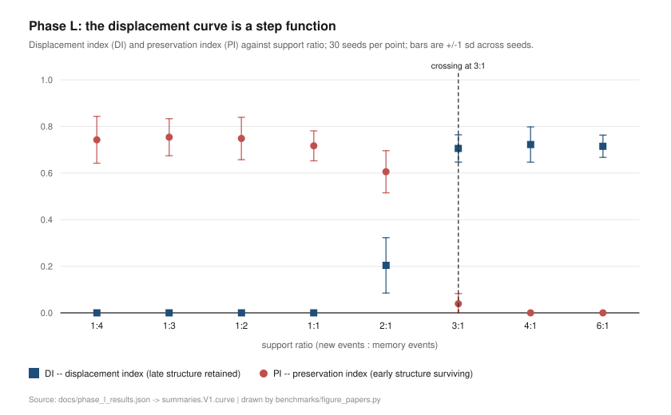
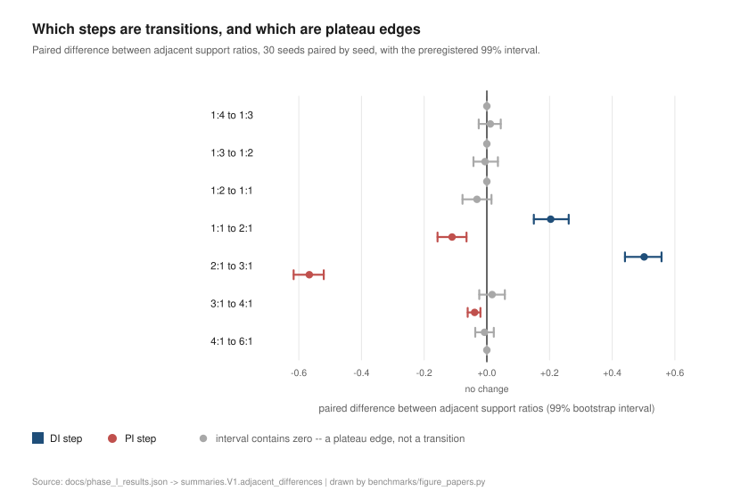
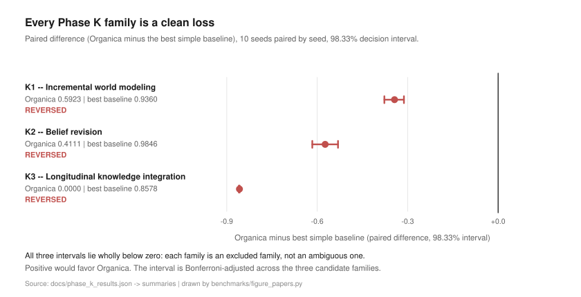
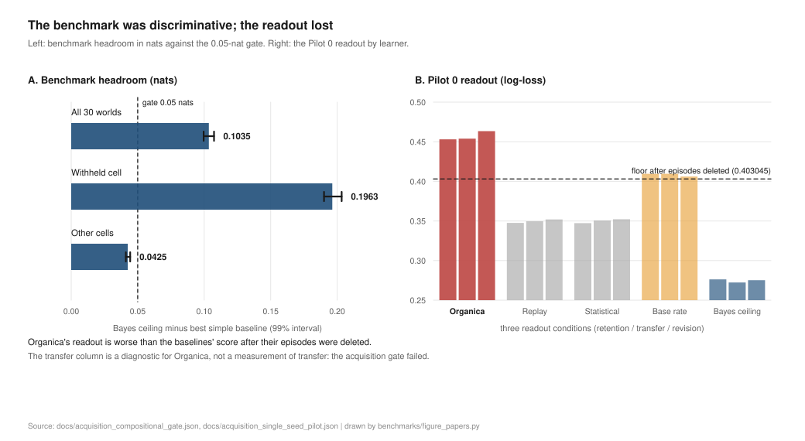
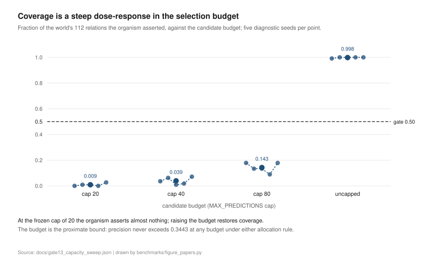

# Paper 1: Developmental Structure Formation in Organica 1

**Authors:** Jeremy et al. (Nuera Research)
**Draft status:** Evidence-alignment revision, 2026-10-27. Academic-grade revision, 2026-10-29: methods and results reconciled to the committed record, with the negative external-task findings and the acquisition campaign retained rather than smoothed. Correction, 2026-10-29: six values in the §4.7 readout table disagreed with the artifact they were transcribed from (`docs/acquisition_single_seed_pilot.json`) in the fourth and fifth decimal, and the transfer column's diagnostic status was not stated; both are corrected in place and recorded at `docs/PILOT-0-INSTRUMENTATION-AUDIT.md` §2.1. Figures added 2026-10-29, generated from the committed artifacts by `benchmarks/figure_papers.py`. Citations added 2026-10-30: §4.1's curriculum-sensitivity framing and §5.4's four methodological lessons now carry inline `(Author, year)` markers and a **References** section with seven sources, each read against a primary record; one of the four lessons is stated as this project's own rule and carries no external citation by design. Not submitted or published.
**Scope:** Organica 1; developmental outcomes and their measurement.
**Repository:** [`nueraresearch/project-organica`](https://github.com/nueraresearch/project-organica), branch `master`.

## Abstract

Project Organica is a developmental architecture that constructs candidate structures from a stream of events through repeated consolidation. We examine what Organica 1 has demonstrated after a sequence of preregistered developmental and external-task studies, and we report the negative results with the same prominence as the positive ones. The evidence supports history- and curriculum-dependent changes in internal structure: different curricula produce different structural trajectories, and prior assumptions that inventory ceilings were fixed were overturned in later experiments. These findings establish developmental dynamics in the operational sense used here; they do not establish human-like learning, open-ended growth, or general intelligence.

In external evaluations, Organica has **not** demonstrated an advantage over the tested lightweight baselines on held-out prediction, latent-structure recovery, regime-shift response, or the Phase K task families. All three Phase K families were **REVERSED** — clean losses whose 98.33% decision intervals lie wholly below zero — and Phase L's preregistered overall verdict was **`H3-L — INCONCLUSIVE`**, unchanged when the sample was raised from 10 to 30 seeds per point. We report why that verdict stands, and why it is not a license to reinterpret the curve.

Finally, we report a **preregistered acquisition experiment that stopped at its own gate**. The benchmark was rebuilt after an endpoint audit found seven defects, and the rebuilt benchmark passes: a compositional task separates a Bayes-optimal model from the strongest simple baseline by **+0.1035 nats** (99% interval **[+0.0996, +0.1074]**), with the gap on a withheld cell **4.6×** the gap elsewhere. On the frozen engine, the acquisition gate **failed on every inspected seed**: the organism asserted **0.0%–2.7%** of the world's relations while its raw memory held **100%** of them. **Transfer was therefore not measured**, and this is reported as *not measurable* — not as a transfer failure. The failure's mechanism was characterized separately, and is not part of this paper's question.

## 1. Research question and scope

**Central question.** *Can developmental structure emerge in Organica 1?*

**The answer, in one line.** **Yes** — internal structure forms, and it varies with the experienced curriculum. **And this paper is mostly about the boundaries of that answer**: the structure that forms does not, on any of the six external task families tested, confer an advantage over simple alternatives, and the preregistered experiment designed to test whether it becomes *reusable* stopped at its own acquisition gate.

The question is narrow on purpose, and it has three separable parts, which this paper answers separately: **(a)** does internal structure form, and does it vary with curriculum; **(b)** does the structure that forms help on later events; **(c)** if it does not, is that the organism's doing, or the task's. A result on one part says nothing about the others, and this paper does not merge them. The audit-trace result, the Phase L protocol verdict and the Gate 13 mechanism characterization are **reported to the extent they bear on this question and are not surveyed here**; the first is a separate manuscript and the other two are separate research records.

The paper does not treat inventory growth as a proxy for intelligence, nor does it assume that a structure is useful because it persists or has a long lineage.

"Development" here means measured change in the architecture's candidate structures over cycles. "Path dependence" means that the measured final state varies with the experienced history or curriculum. The existing curriculum comparisons vary event content and presentation schedule together; they do **not** isolate strict order dependence while holding the event multiset constant. We therefore use **schedule dependence** for the established finding and mark strict order dependence as untested.

Three **further** questions are kept apart in the acquisition analysis (§4.7), because conflating them hides the cause:

1. **Is the benchmark discriminative?** Does the task separate a good model from a strong simple baseline at all?
2. **Does the organism hold the structure?** Is the world's relation present in the organism's memory?
3. **Does the organism beat the baselines?** Does it *use* what it holds?

A result on one of these says nothing about the others. Much of the confusion in the developmental-systems literature comes from reporting a single number where three were needed.

### 1.1 What this paper does not claim

It does not claim that developmental structure becomes reusable knowledge — that question is **open**, and the acquisition experiment designed to answer it stopped before reaching it. It does not claim that the displacement curve has a boundary. It does not claim that belief revision, strict order dependence, or cross-domain transfer has been demonstrated; each is separately measured, and each measured result is negative or untested (§4.9).

## 2. Architecture under test

### 2.1 The engine

Organica 1 receives tagged event streams and periodically forms higher-level candidates through fixed engine procedures. The engine has built-in inductive structure, including a tag extractor, candidate types, thresholds, persistence rules, and a fixed consolidation process. It is therefore a system without pretrained domain content, not a system without prior structure or assumptions.

Structures are organized in **eight generational primitives above a G0 experience substrate**, each synthesized strictly from the one below it: raw events (G0, the substrate); concepts, predictions and loops (G1); meta-concepts and processes (G2); workflows (G3); hypotheses (G4); theories and questions (G5); dreams (G6); investigations (G7); and experiments (G8). Six architectural laws govern the process — upward induction, provenance, cognitive isolation, grounded dreaming, expected-information-gain attention, and natural selection.

The implementation should be reported as it exists, not as an idealized hierarchy: each claimed layer or capability requires a direct mapping to the frozen code and an observable output, and the project's architecture reference is [`docs/architecture.md`](../docs/architecture.md).

### 2.2 The freeze, and one disclosed discrepancy

Organica 1 is frozen at tag **`v0.9.0`** and enforced by a test: `tests/test_v1_freeze.py` compares every frozen file against that tag and fails if one differs (16/16 files verified at the Phase L run). The engine is a fixed reference object; everything after the freeze measures it and nothing changes it quietly. The audit instrumentation is separately frozen at tag **`audit-trace-v1`**; the package version `0.10.0` is deliberately **untagged**, because that tag marks the instrumentation, not a release.

One discrepancy is disclosed and left in place: **Law II** states that every structure's `parent_ids` are traceable to G0 events, and in the frozen engine the chain **terminates at Layer 1** — no parent link points at an experience event. The discrepancy is recorded as **D3** in the audit-trace specification because the frozen engine's constitution is the owner's decision, not a documentation fix. It does not affect any measurement reported here, but it does mean the architecture description in §2.1 must be read with that limit.

## 3. Methods

### 3.1 The studies, and what each was for

The record is a sequence of preregistered studies, each answering one question. No study was designed to be rescued by a later one.

| Study | Question | Population | Outcome |
|---|---|---|---|
| **Phase H** | held-out next-event prediction; latent-structure recovery | synthetic worlds | negative |
| **Phase I** | regime-shift detection | synthetic worlds, shift mid-run | negative — no family met its success rule |
| **Phase J** | gradual post-shift adaptation | synthetic worlds, two families | negative — neither primary gate passed, in either family |
| **Phase K** | *what is Organica uniquely good at?* — a search over three families | 10 seeds per family | **all three REVERSED** |
| **Phase L** | plasticity–coherence: does development displace early structure? | 30 seeds per sweep point (240 cells) | `H3-L — INCONCLUSIVE` |
| **Acquisition** | can a controlled experience leave behind a reusable structure? | preregistered, Revision 3 + Amendment 3 | **stopped at the acquisition gate** |
| **Audit trace** | can an outside observer reconstruct the organism's surviving state? | instrument probe, 3 arms | exact reconstruction, bounded scope |

### 3.2 Decision rules, seeds and intervals

| Study | Seeds | Decision interval | Rule |
|---|---|---|---|
| Phase K | 10 (20261023–20261032) | 98.33% (Bonferroni across 3 families) | paired percentile bootstrap over per-seed differences; SUPPORTED only if Organica − best simple baseline lies wholly above zero |
| Phase L | 30 per point (20261023–20261052) | 99.00% (α = 0.01) | 10,000 paired bootstrap replicates, **paired across seeds by seed**, `PYTHONHASHSEED=0` |
| Acquisition | diagnostic 20261100–20261105; confirmatory 20261106–20261130 (25) | 99% paired bootstrap | acquisition gate first; if it fails, transfer is reported not measurable |

The paired bootstrap pairs by **seed**, not by list position. Pairing by position would break the pairing whenever the two arms deliver their cells in different orders — a defect found in the n=10 run and fixed before the raise-n run.

### 3.3 Baselines, and the rule about which baseline

Every external task is scored against the **strongest simple baseline** that could plausibly solve it, not against a base rate. This choice changed a result: the redesigned transition world's law is **first-order Markov**, and against a base rate the task looked discriminative while against the strongest simple model it was not. The headroom over base rate was 0.105032 (which passes); over the strongest simple baseline it was **0.005647** (which fails). The world was reclassified **CALIBRATION / CONTROL** on the strength of that comparison alone.

For the acquisition benchmark, the strongest simple baseline is a tuned, decayed bigram; it binds in **23 of 30** worlds, with a cell-frequency counter binding in the other **7**.

### 3.4 Instrument audits

Each study carries audits that run **before** the campaign, and the campaign does not run if an audit fails. Phase L ran four (discrimination control, ceiling check, degeneracy audit ensuring every cell has a full denominator, and a selection-pressure audit confirming the belief cap binds: peak beliefs 11 → 15). **Unmeasurable cells: 0.** Phase K ran two, one of which re-ran a task whose loss was already known — **0.412605 against 0.504039** for a first-order Markov baseline — to prove the pipeline can report a loss. A control that could only ever confirm itself would be worthless.

A separate degeneracy audit was added after the Phase L pilot, because two audits had passed on a broken world: they checked the *metric*, and the metric was perfect, while the *design* was dead.

### 3.5 Correction history, recorded rather than applied silently

This paper reports a corrected record. The corrections are listed because a reader deserves to know which numbers are first-time results and which are corrections of earlier ones.

- **Four pilot defects** in the Phase L harness were found and fixed before the primary axis ran, including a ratio with no denominator being reported as zero and a bootstrap resampling the wrong statistic.
- **Seven endpoint defects** were confirmed against the code in the acquisition endpoint audit, including a degenerate primary metric whose Bayes-optimal value (0.0000) was identical to the trivial model's, a directional projection applied to an undirected gold relation, and a "ceiling" that was in fact a relation oracle. The benchmark was rebuilt; the old endpoint's readings were superseded, not quietly replaced.
- **Five sentences** in the project's own summary were wider than the checks behind them, and all five were narrowed before the acquisition experiment ran (§4.9). The summary is where widening happens: the measurements were right and the headlines were wrong, and a wrong headline is invisible in a diff — it looks exactly like a right one.
- **Two gates shared one name and disagreed.** The acquisition harness measured the acquisition gate on a *raw-temporal* basis (100%, passed) while the runner measured it on the *asserted* basis (0.0%, failed) — the same seed, the same world, one name. The harness now implements the protocol's dual accounting, gates on the asserted basis, and carries a treatment arm that must pass; the test asserts the gate **fails** on the frozen engine. A gate that cannot fire is decoration.

## 4. Results

### 4.1 Curriculum sensitivity

The developmental record documents curriculum-sensitive trajectories and repeated movement beyond earlier inventory attractors. Different curricula produce different structural trajectories, and the assumption that inventory ceilings were fixed was overturned in later experiments.

*Curriculum* carries its established sense from the machine-learning literature, where it names training strategies that present examples in a meaningful order rather than at random — gradually more concepts, and gradually more complex ones (Bengio et al., 2009) — and where the effect of the curriculum on the trained model is a measured quantity, reported as changes to generalization capacity and convergence rate (Wang, Chen & Zhu, 2021). The question this section asks of Organica 1 is the narrow version of that one: does the structural trajectory vary with the experienced history?

What this establishes is **schedule dependence**: the measured final state varies with the experienced history. What it does **not** establish is **strict order dependence** — the curriculum comparisons vary the event multiset and order together, so an organism that merely accumulated evidence into a commutative bag would also look path-dependent. Isolating order requires the multiset held fixed, and that comparison has not been run.

### 4.2 Phase L: the displacement curve is a step function

The primary axis measures a support ratio (8 sweep points from 1:4 to 6:1) and reports two indices: **DI**, the displacement index (how much late structure is retained) and **PI**, the preservation index (how much early structure survives). 240 of 240 cells complete, 30 seeds per point.

| Label | DI (sd) | PI (sd) | DS | Revision latency (cycles) | Seeds reaching DI > 0.5 |
|---|---|---|---|---|---|
| 1:4 | 0.000 (0.000) | 0.743 (0.101) | −0.743 | — | 0/30 |
| 1:3 | 0.000 (0.000) | 0.754 (0.079) | −0.754 | — | 0/30 |
| 1:2 | 0.000 (0.000) | 0.748 (0.091) | −0.748 | — | 0/30 |
| 1:1 | 0.000 (0.000) | 0.717 (0.064) | −0.717 | — | 0/30 |
| 2:1 | 0.204 (0.119) | 0.606 (0.090) | −0.402 | — | 0/30 |
| 3:1 | 0.706 (0.059) | 0.039 (0.044) | +0.667 | 356 | 30/30 |
| 4:1 | 0.722 (0.076) | 0.000 (0.000) | +0.722 | 291 | 30/30 |
| 6:1 | 0.715 (0.048) | 0.000 (0.000) | +0.715 | 244 | 30/30 |

**The shape is a step function, not a ramp.** DI is exactly 0.000 across 1:4–1:1 for all 30 seeds — the late structure is never incorporated at those ratios — and saturates at ≈0.71 across 3:1–6:1. Two sharp transitions (1:1 → 2:1 and 2:1 → 3:1) separate three plateaus. Revision latency is abrupt, not gradual: 0/30 seeds reach DI > 0.5 below 3:1, and 30/30 reach it at 3:1, in a mean of 356 cycles.

**Figure 1.** The displacement curve is a step function. DI (blue squares) is exactly zero across 1:4–1:1, rises at 2:1, and saturates at ≈0.71 from 3:1 onward; PI (red circles) runs the other way, near 0.75 at the low end and exactly zero from 3:1 onward. Bars are ±1 standard deviation across the 30 seeds at each point. The dashed line marks the crossing at 3:1. Drawn from `docs/phase_l_results.json` by `benchmarks/figure_papers.py`.

### 4.3 The four pre-committed criteria, and why two fail

| # | Criterion | n = 10 | n = 30 | Evidence at n = 30 |
|---|---|---|---|---|
| 1 | **DI monotone increasing** | met | **NOT MET** | DI dips at the top: 4:1 0.722 → 6:1 0.715, a step of −0.007 **[−0.037, +0.022]** |
| 2 | **PI monotone decreasing** | not met | **NOT MET** | PI rises at the bottom: 1:4 0.743 → 1:3 0.754, a step of +0.011 **[−0.026, +0.044]** |
| 3 | **DI range ≥ 0.25 and the crossing interior** | met | met | range 0.722; crossing at 3:1, interior to the sweep |
| 4 | **The RT interval excludes both endpoints** | met | met | **[5.0, 5.0]**, 10,000 / 10,000 replicates found a crossing |

**Terminal outcome: `H3-L — INCONCLUSIVE`.** The protocol's remedy for this outcome is *raise n; conclude nothing*, and **no Phase L outcome authorises a V2**. The secondary arms V2–V5 were not run.

Criterion 1 **flipped** between n=10 and n=30, because the top of the curve carries a −0.007 step whose 99% interval contains zero. Both failing criteria are therefore sign tests on steps that are **indistinguishable from zero**, and the adjacent-difference diagnostic confirms it: every step whose interval excludes zero is a real transition (1:1 → 2:1, +0.204 [+0.148, +0.261]; 2:1 → 3:1, +0.502 [+0.443, +0.559]; 3:1 → 4:1 on PI, −0.039 [−0.059, −0.020]), and every step whose interval contains zero is a plateau edge.

**Figure 2.** Every adjacent step in the sweep, for both indices, with its preregistered 99% paired-bootstrap interval. Colored marks are steps whose interval excludes zero — the two transitions in DI (1:1 → 2:1 and 2:1 → 3:1) and the drop in PI (2:1 → 3:1, 3:1 → 4:1). Gray marks are steps whose interval contains zero, which are plateau edges rather than transitions. This is the diagnostic behind the two failing criteria: each failure is the sign of a difference indistinguishable from no change. Drawn from `docs/phase_l_results.json` by `benchmarks/figure_papers.py`.

A criterion that flips when n changes is measuring the draw, not the organism.

### 4.4 The crossing is the most stable quantity in the phase

| Quantity | n = 10 | n = 30 |
|---|---|---|
| Crossing label | 3:1 | **3:1** |
| Sweep position | 5 of 7 interior | 5 of 7 interior |
| Paired-bootstrap interval (99%) | [5.0, 5.0] | **[5.0, 5.0]** |
| Replicates that found a crossing | 10,000 / 10,000 | **10,000 / 10,000** |
| Robustness — 8 alternative bootstrap seeds | INTERIOR (8/8) | **INTERIOR (8/8)** |
| Leave-one-seed-out crossings | 3:1 in 10 of 10 | **3:1 in 30 of 30** |

Tripling n did not move the crossing, and dropping any single seed leaves it at 3:1.

**The scope of that stability must be stated with it.** The eight alternative bootstrap seeds test **resampling stability, not new worlds** — they re-draw from the same measured seeds. Leave-one-out is the same check on the same data. The crossing at 3:1 is therefore robust **within this engine, this world family, and this support-ratio axis**, and it is **not** a general threshold for Organica.

### 4.5 What resampling says about the criteria themselves

Resampling the 30 measured seeds and recomputing the four criteria (run *after* the outcome was known; it changes no criterion, no verdict and no prediction):

| Criterion | random 10-seed subsets | random 20-seed subsets | n = 30 |
|---|---|---|---|
| 1. DI monotone increasing | 19.3% | 16.1% | 0% |
| 2. PI monotone decreasing | 12.0% | 6.6% | 0% |
| 3. DI range ≥ 0.25 | **100.0%** | **100.0%** | met |
| 3b. Crossing interior to the sweep | **100.0%** | **100.0%** | met |
| **All four together** | **2.9%** | **1.2%** | 0% |

Criteria 3 and 3b are properties of the system: they hold in every resample. Criteria 1 and 2 are mostly properties of the draw: a random 20-seed subset satisfies both monotone criteria only 1.2% of the time, and the n=10 run's criterion-1 pass was itself one of the lucky 19%.

**Strict monotonicity is not a property this curve has**, at any practical n: the low end is exactly 0.000 and the high end saturates at ≈0.71. More seeds cannot make a plateau into a ramp. This is the substantive content of the raise-n run, and it is **not** a license to re-score the protocol.

### 4.6 Six negative external task families

Three negatives from Phase H, I and J prompted a *search* rather than a verdict: Phase K asked what the architecture is uniquely good at, across three families each derived from a mechanism the project had actually measured.

| Family | Organica (mean) | Best simple baseline (mean) | Paired difference | 98.33% interval | Verdict |
|---|---|---|---|---|---|
| **K1** — incremental world modeling | 0.5923 | 0.9360 | **−0.3437** | [−0.3773, −0.3123] | **REVERSED** |
| **K2** — belief revision | 0.4111 | 0.9846 | **−0.5735** | [−0.6162, −0.5309] | **REVERSED** |
| **K3** — longitudinal integration | 0.0000 | 0.8578 | **−0.8578** | [−0.8598, −0.8571] | **REVERSED** |

Not one is SUPPORTED, and not one is INCONCLUSIVE: every decision interval lies wholly below zero, so each family is a **clean loss** rather than an ambiguous one.

**Figure 3.** The three Phase K families, as paired differences (Organica minus the best simple baseline), 10 seeds paired by seed, with the preregistered 98.33% decision interval. Every interval lies wholly below zero: each family is an excluded family, not an ambiguous one. The figure shows the three Phase K families only; the three earlier negative families are reported in the text above, and are not pooled into it because their metrics are not on a common scale with these. Drawn from `docs/phase_k_results.json` by `benchmarks/figure_papers.py`.

The three earlier families were negative too. Held-out next-event prediction scored **0.413** against a first-order Markov baseline's **0.504** (a decayed variant reached 0.485); latent-structure recovery scored **0.704 / 0.547 / 0.109** against **0.800 / 0.764 / 0.796**; regime-shift detection had no family meet its preregistered success rule; and gradual post-shift adaptation had neither primary gate pass, in either family.

**Six negative families is not a verdict on the architecture** — it is six excluded families and one open question. The matched mechanism ablations in Phase K (no questions, no falsification, no dreams) changed nothing measurable, which is why the next useful step was a *mechanism* question rather than another task family.

### 4.7 The acquisition experiment: a discriminative benchmark, and a failed organism

This was the decisive question: does developmental structure become **reusable knowledge**?

**The benchmark was rebuilt first.** An endpoint audit confirmed seven defects against the code, including a primary metric (F1 at 0.5) whose Bayes-optimal value was **0.0000** — identical to the trivial model's, so the metric was degenerate — and a "fixed-rule ceiling" that was actually a relation oracle. The rebuilt task is **compositional**: a 2×2 latent grid, four tags per cell, a successor that differs in exactly one factor, a randomized tag-to-cell mapping per world, and one held cell per world removed from the training stream.

**The rebuilt benchmark is discriminative.** Across 30 worlds, the gap between the Bayes ceiling and the strongest simple baseline is **+0.1035 nats**, 99% interval **[+0.0996, +0.1074]**. The gap is not estimation error: on the withheld cell it is **+0.1963 [+0.1901, +0.2033]**, against **+0.0425 [+0.0411, +0.0444]** elsewhere — **4.6×**. A positive control reaches the ceiling and a deliberately broken control is at least +0.1015 worse. (A sensitivity check that swapped the weights of the two factors was +0.0307 worse [+0.0283, +0.0332] — reported, not gated.)

**The frozen engine failed the acquisition gate on every inspected seed.**

| Seed class | Asserted structure coverage | Raw temporal coverage |
|---|---|---|
| `20261100` (exploratory) | 0 / 112 = **0.0%** | 112 / 112 = **100%** |
| `20261101`–`20261105` (diagnostic) | **0.0% – 2.7%** (0–3 of 112) | 112 / 112 = **100%** |

The world's relations **are** in memory. The organism did not **assert** them.

**The readout lost.** On the Pilot 0 seed, with identical raw exposure for every learner (log-loss; lower is better):

| Learner | Retention | Transfer (diagnostic for Organica) | Revision |
|---|---|---|---|
| **Organica** | **0.453018** | 0.453886 | 0.463391 |
| Replay | 0.347521 | 0.349592 | 0.351989 |
| Statistical | 0.347273 | 0.350723 | 0.352194 |
| Base rate | 0.409581 | 0.409529 | 0.406084 |
| Bayes ceiling | 0.276259 | 0.272383 | 0.275208 |

Organica scored worse than the baselines did *after their episodes were deleted* (the 0.403045 floor those cells collapse to). This is coherent with the cause rather than surprising: the asserted structure is mostly within-cell co-occurrence, so the readout answers *which cell the context is in* when the task asks *which cell comes next*.

**Transfer was not measured, and it is not a transfer failure.** Per the protocol, a seed that fails acquisition is reported `acquisition_failed`, and transfer is reported as *not measurable*. The 600-cell factorial did not run. The transfer column above is therefore a **diagnostic**, not a measurement of transfer: the artifact stores Organica's value under the key `transfer_diagnostic`, and the Pilot-0 audit labels the column "Transfer Diagnostic" for that reason. The baselines' and reference models' transfer figures are measured values on the same window.

*Corrected 2026-10-29:* six values in this table were transcribed from `docs/PILOT-0-INSTRUMENTATION-AUDIT.md` §2, which disagreed with the artifact `docs/acquisition_single_seed_pilot.json` in the fourth and fifth decimal (the largest gap was $6.7\times10^{-5}$). The table above now carries the artifact's values, read mechanically. No verdict in this section changes; the correction and its cause are recorded at `docs/PILOT-0-INSTRUMENTATION-AUDIT.md` §2.1.

**Figure 4.** The benchmark was discriminative, and the readout lost. Panel A: the headroom of the Bayes ceiling over the strongest simple baseline, in nats, with the preregistered 0.05-nat gate — +0.1035 overall, +0.1963 on the withheld cell and +0.0425 elsewhere. Panel B: the Pilot 0 readout by learner (log-loss, lower is better), with the floor the baselines collapse to once their episodes are deleted. Organica's readout is worse than that floor. Drawn from `docs/acquisition_compositional_gate.json` and `docs/acquisition_single_seed_pilot.json` by `benchmarks/figure_papers.py`.

### 4.8 Why the acquisition gate failed (summary; the characterization is a separate record)

The failure was characterized by four diagnostic probes, all run on **diagnostic** seeds — the confirmatory sample (`20261106`–`20261130`, 25 seeds) is untouched. The full characterization is a **separate record** ([`docs/GATE13-CAUSAL-ACCOUNT.md`](../docs/GATE13-CAUSAL-ACCOUNT.md), [`docs/GATE13-RELATION-SEPARATION.md`](../docs/GATE13-RELATION-SEPARATION.md), [`docs/GATE13-RANKING-CRITERION.md`](../docs/GATE13-RANKING-CRITERION.md)), and only its conclusions bear on this paper's question:

- **The proximate bound is a 20-candidate selection budget.** Coverage is a steep dose-response in it: **0.0000–0.0268** at cap 20, rising to **0.9911–1.0000** uncapped, and requiring **240–244** asserted edges — about **12×** the budget.
- **The deeper constraint is precision, not capacity.** Precision **never exceeds 0.3443** at any budget under either allocation rule, and a per-source rule is not the fix. A 1-tag stimulus, which removes within-cell pairs by construction, still fails **0 of 6** seeds.
- **The relation table mixes the world's relations with the organism's own descriptive vocabulary.** The substrate is **201×–341×** engine-generated, and a provenance filter (oracle-free — it uses `event_type`, already in the schema) removes **35.7%–40.7%** of the table and is **not sufficient**: coverage stays at **0.0000–0.0446** at the frozen cap.
- **No criterion the engine already stores can fix the ranking.** A 60-cell grid over those fields reached a best cell of **0.0804** coverage at **0.4500** precision against a **0.50** gate, and the engine's own normalized criterion selects **20 engine-vocabulary edges and 0 world edges**.

This account is a candidate for a future manuscript. It is an explanation of *why* this one gate failed, not evidence about developmental structure, and it is not part of this paper's question.

**Figure 5.** The proximate bound, measured. The fraction of the world's 112 relations that the organism asserted, against the candidate budget, for five diagnostic seeds per point. At the frozen cap of 20 the organism asserts between 0.0000 and 0.0268 of the relations; removing the cap restores 0.9911–1.0000. The budget is the proximate bound and not the deepest cause — precision never exceeds 0.3443 at any budget under either allocation rule. Drawn from `docs/gate13_capacity_sweep.json` by `benchmarks/figure_papers.py`.

### 4.9 Claim status

Every headline claim this project has made, with its status and the scope of the evidence behind it. The categories are deliberately four rather than two: a claim that was **not established** is not a claim that was **refuted**, and a claim that is **reversed** is a stronger statement than one that is merely unsupported.

| Claim | Status | Evidence and scope |
|---|---|---|
| Developmental structure forms and varies with experience | **Supported within the tested scope** | DI/PI curves over 8 sweep points, 240 cells, 30 seeds per point; four instrument audits, 0 unmeasurable cells (§4.2) |
| The displacement crossing at 3:1 is stable | **Supported within the tested scope** | 10,000/10,000 bootstrap replicates, 8/8 alternative bootstrap seeds, leave-one-out at 3:1 in 30/30 folds — **within this engine, this world family and this axis** (§4.4) |
| Phase L structural displacement occurs | **Measured; the protocol verdict `H3-L` remains inconclusive** | the displacement itself is measured (DI 0.000 → ≈0.71); the *protocol's* verdict on the tradeoff is inconclusive, and the two must not be merged (§4.2, §4.3) |
| A continuous coherence–plasticity tradeoff | **Not established**; the preregistered Phase L verdict was inconclusive | two of four pre-committed criteria not met; the curve has plateaus, so strict monotonicity is not a property it has at any practical n (§4.3, §4.5) |
| The displacement curve has a *boundary* | **Not established** | the crossing is stable, but stability within one axis is not a boundary in the tradeoff sense (§4.3–§4.5) |
| Path dependence in general | **Mixed / context-limited** | the curriculum comparisons vary the event multiset and order together, so **schedule dependence** is established and **strict order dependence is untested** (§4.1) |
| Organica performs belief revision better than simple baselines | **Reversed in Phase K's tested task**; this does not establish that no updating occurs | K2: 0.4111 vs 0.9846 for the best simple baseline, −0.5735, 98.33% [−0.6162, −0.5309] (§4.6) |
| Organica shows an advantage over simple alternatives on external tasks | **Reversed** on the six families tested; this is not a general negative result about developmental architectures | all six families negative; three Phase K families REVERSED with intervals wholly below zero (§4.6) |
| Transfer | **No positive transfer demonstrated**; one measured cross-domain result was negative, while other forms remain untested | cross-domain transfer −0.4863 across 12 domain pairs, mean shared vocabulary 0.17 tags (§4.10) |
| Developmental structure becomes **reusable knowledge** | **Not established / not measured** | the preregistered experiment **stopped at its acquisition gate**; transfer reported *not measurable*, which is **not** a transfer failure (§4.7) |
| The acquisition benchmark is discriminative | **Supported within the tested scope** | gap +0.1035 nats, 99% [+0.0996, +0.1074]; held cell 4.6× the rest; a positive control reaches the ceiling and a broken control is ≥ +0.1015 worse (§4.7) |
| The organism's surviving state can be reconstructed from outside | **Supported within the tested scope** | exact reconstruction in three arms with proof-of-firing tests — **tested surviving state only**; not complete historical reconstruction, and not outside-laboratory replication |
| Complete historical reconstruction | **Not demonstrated**; the trace is bounded to surviving state | the bound is a property of **this implementation** (a 4,000-event window ≈ 1.7 cycles), **not** an impossibility result for any system |
| Human-like learning | **Not established** | no supporting measurement in this record |
| General intelligence | **Not established** | no supporting measurement in this record |

### 4.10 Five sentences that were wider than their checks

The project's own summary had drifted. All five were narrowed before the acquisition experiment ran, and they are listed here because the drift is instructive and because a reader of an earlier version of this project will have met the wider versions.

| The wider claim | What was measured |
|---|---|
| "Revision exists" | **Structural displacement.** Phase L's DI/PI are structure-retention indices. Belief revision was measured separately, and **lost**: 0.4111 against the best simple baseline's 0.9846 (−0.5735, 98.33% [−0.6162, −0.5309], REVERSED). |
| "A 3:1 threshold" | Robust **within this engine, this world family and this support-ratio axis**. Alternative bootstrap seeds re-draw from the same measured seeds: resampling stability, not new worlds. |
| "Path dependence" | **Schedule dependence.** The curriculum comparisons vary the event multiset and order together; strict order dependence is untested. |
| "Transfer" | **No positive transfer demonstrated**, and the measured cross-domain result was **negative**: −0.4863 across 12 domain pairs, with a mean shared vocabulary of 0.17 tags. Other forms of transfer remain untested. |
| "Independently auditable" | Independently **reconstructed from the engine's state** — never independently **replicated by another laboratory**. The trace concerns surviving *current* structures, not their full past. |

## 5. Discussion

### 5.1 What Organica 1 demonstrated

**Development occurs and is curriculum-sensitive.** Measured change in candidate structures over cycles, with trajectories that vary by experienced history, and with inventory ceilings overturned by later experiments. This is development in the operational sense used here and in no stronger sense.

**The displacement curve has a reproducible shape.** A preservation plateau, a transition band, a displacement plateau, and a crossing at 3:1 that survives every check applied to it.

**The selection machinery is exact enough to be reconstructed from outside.** The engine's own contest can be rebuilt cycle by cycle from persisted state, without a hook inside the engine, and the reconstruction can be shown to be wrong when it is wrong (see the companion audit paper).

### 5.2 What it did not demonstrate

No advantage over simple alternatives on any of six external task families. No reusable knowledge: the question was preregistered, the benchmark was rebuilt to be discriminative, and the organism failed the gate before the transfer question could be asked. No belief revision, no strict order dependence, no positive transfer, and no boundary in the curve.

### 5.3 Why the negative results are informative

A clean loss against the strongest simple baseline is more informative than an inconclusive result, because it rules something out. All three Phase K families were REVERSED — the intervals lie wholly below zero — and the matched ablations changed nothing measurable. That combination does not say *what* the architecture is good at; it says that three specific mechanisms are not it, and it converts the next question from *"can it do X?"* into a **mechanism** question.

The acquisition result is the sharpest instance. The benchmark is discriminative, the raw memory holds the world's relations, and the organism nonetheless fails to assert them. That is a specific, attributable failure with a located mechanism — and it is why the failure is worth reporting rather than re-running until something else appears.

### 5.4 Methodological lessons with reach beyond this project

Four are general enough to state plainly.

**A criterion that flips when n changes is measuring the draw.** The monotonicity criteria held in 19.3% of random 10-seed subsets. A pre-registered criterion that a large fraction of draws would fail is a criterion about sampling, not about the system. This is the power problem stated as a criterion problem: a study with low statistical power has a reduced chance of detecting a true effect, and — less well appreciated — low power also reduces the likelihood that a statistically significant result reflects a true effect, which shows up as overestimates of effect size and low reproducibility (Button et al., 2013). A second and independent source of the same symptom is analytic flexibility, which inflates the actual false-positive rate far above the nominal one however carefully the analysis is planned (Simmons et al., 2011); the remedy that source prescribes — disclose what was decided, before the outcome is known — is a practice this project already follows, and the check added on top of it here is to measure the criterion's own pass rate under resampling rather than trust one draw.

**Compare against the strongest simple baseline, and take the headroom from the ceiling.** The redesigned world's headroom was 0.105032 over a base rate and 0.005647 over the strongest baseline — the same task, opposite verdicts. This one is this project's own rule and is stated here as such, with no external citation: the comparison is against the strongest simple baseline that could plausibly solve the task, and the headroom reported is the gap between the Bayes ceiling and that baseline, which is a property of the benchmark and not a margin any learner achieved.

**An endpoint must measure the claim it is used for.** Seven defects, confirmed against the code, including a primary metric whose Bayes-optimal value was identical to the trivial model's. The general form of this is the mismatch between the construct a study means to measure and the operationalization it actually computes, which can invalidate a result however carefully the rest of the design is executed (Jacobs & Wallach, 2021).

**A bounded selection is not a selection rule.** Before enlarging a budget, check whether the ranking can find the signal *at all*: measure the coverage ceiling with the budget removed, the precision at each budget, and the same curves under a different allocation rule. If precision is flat and low across budgets and rules, the defect is the candidate space, and the right question is *"can this be ranked by something other than frequency?"* — not *"how much budget?"* The candidate set here is skewed the way an imbalanced classification problem is skewed — the world's 112 edges are a small minority of the relation table — and on skewed data a precision–recall curve gives the more informative picture of a system's performance, even though a curve's dominance in ROC space and in PR space coincide (Davis & Goadrich, 2006). What made this visible is that the aggregate curve looked reassuringly dose-responsive while the fraction of selected edges that were real — the quantity a precision–recall curve reports, and one a ROC curve's visual interpretability can hide — never exceeded 0.3443 at any budget under either allocation rule (Saito & Rehmsmeier, 2015).

## 6. Limitations

- The evidence is from synthetic and task-specific environments, and does not show learning like a human.
- Curriculum sensitivity is not strict order dependence.
- Increasing inventory is not evidence of prediction, transfer, causal understanding, or improved future learning.
- Six negative families exclude six families; they do not constitute a general negative result about developmental architectures.
- The 3:1 crossing is robust within one engine, one world family and one axis; it is not a general threshold.
- The acquisition benchmark's **+0.1035 nats is the benchmark's headroom** — the room between the ceiling and the best simple model — and is **not** a margin any learner achieved. The engine achieved nothing on that task; it failed the acquisition gate.
- Transfer was not measured, and this is reported as *not measurable* rather than excluded as zero.
- The acquisition campaign's confirmatory sample (25 seeds) is **untouched**; every seed used in the mechanism probes is diagnostic.
- The audit results apply to the reconstruction tasks and tested engine states; they do not establish independent replication by another laboratory or complete reconstruction of lost historical state.
- The engine is frozen. Every measurement here is of one specific implementation, and Law II's divergence from its own text (§2.2) remains open.

## 7. Conclusion

Organica 1 provides evidence for curriculum-sensitive developmental structure formation. It has **not** shown that this development produces reusable knowledge, and it has not shown an advantage over simple alternatives on any external task family tested. The acquisition study is preregistered, its benchmark was rebuilt and independently shown to be discriminative, and it **stopped at its own gate** — so the question it was built to answer remains open, and is reported as open.

The most useful thing this record contributes is a set of attributable negative results and the instruments that produced them: a benchmark that can fail, an endpoint that was audited before use, gates that were shown able to fire, and a mechanism account that names which part of the system is responsible and how much of the explanation has been measured.

## Data and code availability

All protocols, results and artifacts are public in the repository at [`nueraresearch/project-organica`](https://github.com/nueraresearch/project-organica) (branch `master`). The engine is frozen at tag `v0.9.0`; the audit instrumentation at `audit-trace-v1`; the package version `0.10.0` is untagged. Protocols were committed before the outcomes they judge, and their amendments are dated and pre-outcome. Canonical result files: `docs/phase_l_results.json` (n = 30, with the n = 10 record preserved unmodified as `docs/phase_l_results_n10.json`), `docs/phase_k_results.json`, `docs/acquisition_compositional_gate.json`, `docs/gate13_capacity_sweep.json`, `docs/gate13_allocation_rule.json`, `docs/gate13_relation_separation.json` and `docs/gate13_ranking_criterion.json`.

## Repository evidence

- [`docs/V1-SYNTHESIS.md`](../docs/V1-SYNTHESIS.md) — the V1 record and its limits
- [`docs/phase_l_results.md`](../docs/phase_l_results.md), [`docs/PHASE-L-SYNTHESIS.md`](../docs/PHASE-L-SYNTHESIS.md) — the measurement record and, kept separate, the characterization
- [`docs/phase_k_results.md`](../docs/phase_k_results.md) — the three REVERSED families
- [`docs/ACQUISITION-ENDPOINT-AUDIT.md`](../docs/ACQUISITION-ENDPOINT-AUDIT.md), [`docs/ACQUISITION-EXPERIMENT-PREREGISTRATION.md`](../docs/ACQUISITION-EXPERIMENT-PREREGISTRATION.md) — the endpoint audit and the preregistration (Revision 3)
- [`docs/GATE13-CAUSAL-ACCOUNT.md`](../docs/GATE13-CAUSAL-ACCOUNT.md), [`docs/GATE13-RELATION-SEPARATION.md`](../docs/GATE13-RELATION-SEPARATION.md), [`docs/GATE13-RANKING-CRITERION.md`](../docs/GATE13-RANKING-CRITERION.md) — the mechanism account
- [`docs/EMERGENCE-CRITERIA.md`](../docs/EMERGENCE-CRITERIA.md), [`docs/architecture.md`](../docs/architecture.md), [`docs/V1-FREEZE.md`](../docs/V1-FREEZE.md)
- [`research-journal/phase_g_findings_20261021.md`](../research-journal/phase_g_findings_20261021.md) — the project's own running record
- [`benchmarks/figure_papers.py`](../benchmarks/figure_papers.py) — the generator that draws every figure in §4 from the committed artifacts, and that refuses to draw a figure whose numbers it cannot find
- [`docs/figure_p01_displacement_curve.svg`](../docs/figure_p01_displacement_curve.svg), [`docs/figure_p01_adjacent_differences.svg`](../docs/figure_p01_adjacent_differences.svg), [`docs/figure_p01_phase_k_families.svg`](../docs/figure_p01_phase_k_families.svg), [`docs/figure_p01_acquisition.svg`](../docs/figure_p01_acquisition.svg), [`docs/figure_p01_capacity_sweep.svg`](../docs/figure_p01_capacity_sweep.svg) — the five figures

## References

Bengio, Y., Louradour, J., Collobert, R., & Weston, J. (2009). Curriculum learning. In *Proceedings of the 26th Annual International Conference on Machine Learning* (pp. 41–48). https://doi.org/10.1145/1553374.1553380

Button, K. S., Ioannidis, J. P. A., Mokrysz, C., Nosek, B. A., Flint, J., Robinson, E. S. J., & Munafò, M. R. (2013). Power failure: why small sample size undermines the reliability of neuroscience. *Nature Reviews Neuroscience, 14*(5), 365–376. https://doi.org/10.1038/nrn3475

Davis, J. J., & Goadrich, M. H. (2006). The relationship between Precision-Recall and ROC curves. In *Proceedings of the 23rd International Conference on Machine Learning* (pp. 233–240). https://doi.org/10.1145/1143844.1143874

Jacobs, A. Z., & Wallach, H. (2021). Measurement and fairness. In *Proceedings of the 2021 ACM Conference on Fairness, Accountability, and Transparency* (pp. 375–385). https://doi.org/10.1145/3442188.3445901

Saito, T., & Rehmsmeier, M. (2015). The precision-recall plot is more informative than the ROC plot when evaluating binary classifiers on imbalanced datasets. *PLOS ONE, 10*(3), e0118432. https://doi.org/10.1371/journal.pone.0118432

Simmons, J. P., Nelson, L. D., & Simonsohn, U. (2011). False-positive psychology. *Psychological Science, 22*(11), 1359–1366. https://doi.org/10.1177/0956797611417632

Wang, X., Chen, Y., & Zhu, W. (2021). A survey on curriculum learning. *IEEE Transactions on Pattern Analysis and Machine Intelligence*. https://doi.org/10.1109/TPAMI.2021.3069908 (preprint: arXiv:2010.13166)

**Source notes.** All seven sources were retrieved and read on 2026-10-30, and each carries one specific claim and is cited for nothing else. **Bengio et al. (2009)** carries the definition of curriculum learning — examples presented in a meaningful order rather than at random — and was read as the authors' abstract, because the ACM Digital Library's full text is not retrievable from this environment. **Wang, Chen & Zhu (2021)** carries curriculum as a training strategy whose effect on the trained model is a measured quantity, reported as changes to generalization capacity and convergence rate; it was read as the arXiv record (arXiv:2010.13166v2), whose comment records acceptance to *IEEE TPAMI*, the venue the DOI resolves to. **Button et al. (2013)** carries the power result — low power reduces the chance of detecting a true effect and, less well appreciated, the likelihood that a statistically significant result reflects a true effect, which shows up as overestimates of effect size and low reproducibility — and was read as the abstract and the PubMed record. **An erratum to Button et al. was published in *Nature Reviews Neuroscience, 14*(6):451 on 15 April 2013 (https://doi.org/10.1038/nrn3502); it corrects the definition of *R* on page 366, which reads in the corrected version as "the pre-study odds (that is, the odds that a probed effect is indeed non-null among the effects being probed)". It touches neither the abstract nor the power conclusions cited here.** **Simmons et al. (2011)** carries the false-positive point — flexibility in data collection, analysis and reporting inflates the actual rate far above the nominal one — and the disclosure-based remedy that follows from it; it was read as the abstract deposited with Crossref and the Europe PMC record. **Jacobs & Wallach (2021)** carries the mismatch between the construct a study means to measure and the operationalization it actually computes, and was read as the authors' abstract. **Davis & Goadrich (2006)** carries the ROC–PR relationship — a curve's dominance in ROC space and in PR space coincide — and the finding that on highly skewed data a precision–recall curve gives the more informative picture; it was read as the authors' abstract. **Saito & Rehmsmeier (2015)** carries the demonstration that a ROC curve's visual interpretability is deceptive with respect to conclusions about the reliability of classification performance on imbalanced data, and was read as the open-access PLOS abstract. The second lesson in §5.4 — *compare against the strongest simple baseline, and take the headroom from the ceiling* — **carries no external citation by design**: it is this project's own rule, it reports only Organica 1's own numbers, and no external source for it was located. Two of the seven sources were reachable only as authors' abstracts, and they are cited only for what those abstracts state. **No claim in this paper depends on a source that has not been read.**
