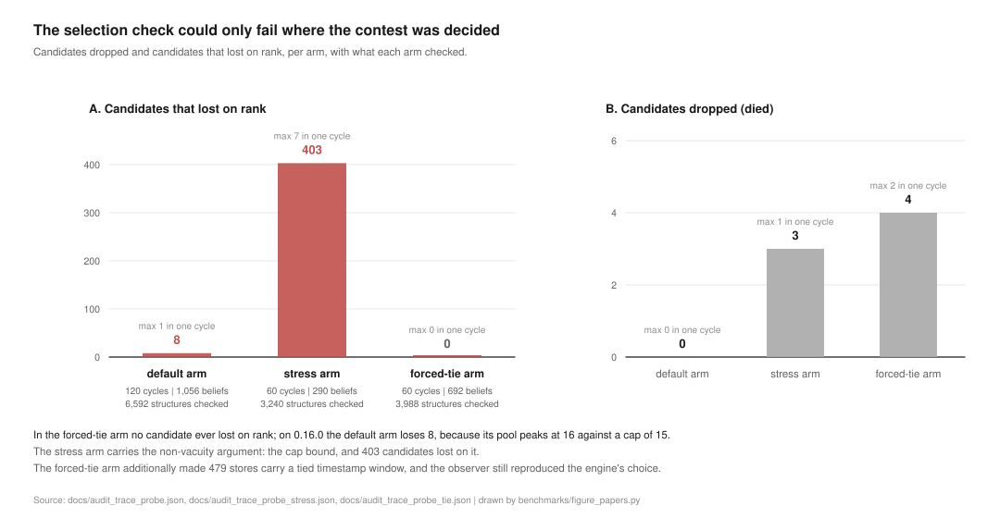
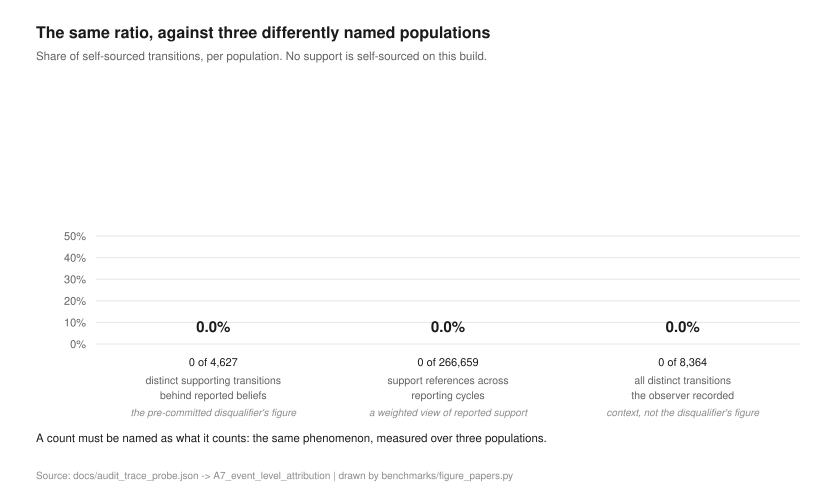
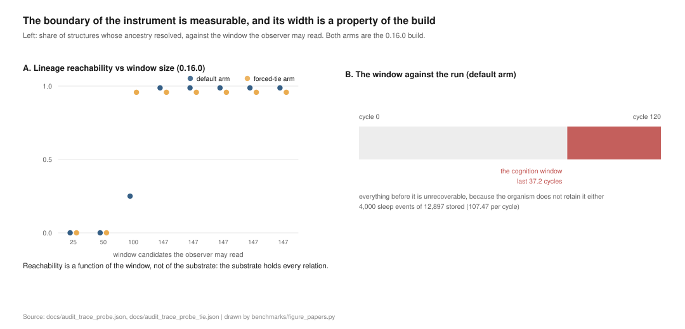

# Paper 2: Reconstructing Evidence and Selection from Organica's Surviving State

**Author:** Jeremy Beebe (Nuera RDL) — https://orcid.org/0009-0009-2394-9714 — jeremy@nueraresearch.com
**Draft status:** Evidence-alignment revision, 2026-10-27; A5/A6 closed and the audit layer frozen at `audit-trace-v1` on 2026-10-28. Academic-grade revision, 2026-10-29: the abstract and §3 still stated that A5 and A6 "remain pending" and that the instrumentation "is not yet frozen", contradicting this line and the conclusion of the same document; the contradiction is corrected here and recorded in this line rather than applied silently. References added 2026-10-29: §2's five sourcing notes now carry named references, each retrieved and read at its cited URL on 2026-10-29, and the section's "Open for submission" note is replaced by the reference list; the note's forward-looking requirement — that the citations be supplied before submission — is met rather than restated. Declarations and sole authorship set for submission, 2026-10-31. Not submitted or published.
**Scope:** Reconstruction fidelity for tested probes and surviving current structures.
**Repository:** [`nueraresearch/project-organica`](https://github.com/nueraresearch/project-organica), branch `master`; instrumentation frozen at tag `audit-trace-v1`.

## Abstract

Developmental systems can expose a record of how their current structures were formed, but a reconstruction claim must specify what the record can recover and under which conditions. We report the Organica audit-trace probes as bounded reconstruction tests, not as proof of universal explainability or complete historical memory. In the measured A3 runs on 0.15.0, all 8,061 of 8,061 structures resolved to Layer 1 within the configured depth, and all 1,412 of 1,412 claims resolved to event identifiers with a world/self evidence split; **on the 0.16.0 regeneration (2026-11-21) the figures are 6,179 of 6,592 (0.937, with 404 reporting no parent) and 1,056 of 1,056.** The stress and forced-tie probes were regenerated on the same build (2026-11-22) and show the same shape — 0.868 and 0.883, with 255 no-parent structures each — while branch-level accounting recorded aged-out ancestors. These results support exact reconstruction of the tested surviving state under the tested SQLite implementation. They do not recover ancestry that the engine itself no longer retains, establish causal sufficiency, or constitute independent replication by another laboratory. A5 field honesty and A6 trace/counterfactual separation are closed (2026-10-28), each verified by a proof-of-firing test, and the audit instrumentation is tagged and frozen at `audit-trace-v1`.

We make three contributions beyond this bounded result. **First, a non-vacuity argument.** A reconstruction test is only informative if the reconstruction was in a position to fail; we therefore report the conditions under which the selection axis became load-bearing (the default arm's candidate cap never bound, so the stress arm — in which 148 candidates lost on rank — carries that test) and the conditions under which it did not. **Second, an explicit accounting of every reported rate.** Self-sourcing is reported against three separately named populations — the distinct supporting transitions behind reported beliefs, the pooled support references across reporting cycles, and all distinct transitions the observer recorded — because, in the reading this paper previously reported, a single unqualified "self-sourced share" **would have** misrepresented the record by more than a factor of two (**17.9 %**, **17.5 %** and **43.2 %**); that gap is why the three populations were named. It is not a present-tense difference: on 0.16.0 all three read **0.0 %** (0 of 4,627; 0 of 266,659; 0 of 8,364), and the earlier non-zero readings came from an observer that read rows the engine does not, so they are withdrawn. **Third, a stated boundary on the instrument's reach.** The cognition window holds 4,000 sleep events, which the engine's own storage rate (107.47 sleep events per cycle on 0.16.0) makes equivalent to 37.2 cycles, so the developmental history of any structure the organism has moved on from is unrecoverable — not slowly censored.

## 1. Introduction

A developmental architecture forms candidate structures from experience. Those structures are then reported: as beliefs, concepts, predictions, hypotheses, workflows. The natural question is whether the system's own account of *why* it holds a belief can be checked. Three positions are commonly taken, and the present work is deliberately narrower than all three.

The first is that the system's self-report is sufficient: the belief carries a support count and a confidence, and those numbers are the explanation. The second is that an outside observer can reconstruct the formation history from the substrate alone, with no reliance on the system's self-report. The third, which we adopt, is that reconstruction is possible **within a stated scope**, and that the scope — which structures, which history, which implementation, which population — must be part of the claim rather than a caveat appended to it.

Our subject is Organica 1, a developmental architecture in which candidate structures are formed by a fixed engine over a stream of tagged events and consolidated across cycles. The engine is frozen at tag `v0.9.0` and the audit instrumentation is frozen at `audit-trace-v1`; no engine file was modified, instrumented, or re-run with different semantics for the measurements reported here.

We report three measurements. **A1** tests whether an outside observer can replay the evidence behind every reported belief; **A2** tests whether it can reproduce the selection contest exactly, including the candidates that died and the candidates that lost on rank; **A7** tests whether it can attribute every supporting transition to specific event identifiers and split them by world/self provenance. **A3** separately tests ancestry honesty, **A4** separately tests that the observer does not perturb the organism, and **A5**/**A6** enforce that every numeric field in the emitted record carries its exact semantics and that no counterfactual field appears in the trace.

The paper's claim is deliberately narrow: *for the tested probes, the tested engine states, and the tested SQLite implementation, an outside observer can reconstruct the surviving developmental state and the evidence behind it exactly, and can be held to account when it is wrong.* It is not a claim of causal explanation, of complete historical recovery, or of independent replication.

## 2. Positioning

This paper sits in the space between two established concerns. The first is **interpretability by external reconstruction**: the practice of building an outside account of a model's internal state that a reader can check, rather than trusting a narrative the model produces about itself — the discipline Elhage et al. describe as reverse engineering a computation "similar to how a programmer might try to reverse engineer complicated binaries into human-readable source code" (Elhage et al., 2021), and which Bau et al. demonstrate concretely by locating and editing a generative model's internal rules from the outside (Bau et al., 2020). The second is **provenance in machine-generated data and scientific workflows**: the requirement that an artifact record where each item came from, so that a downstream claim can be traced and a contamination source can be identified — the requirement the PROV data model formalizes for general workflows (Moreau & Missier, 2013), and the one that becomes acute when a system's own output becomes its input (Shumailov et al., 2024).

Organica's audit trace is an instance of the first applied to a developmental system, with the discipline of the second: every reported belief must resolve to concrete event identifiers, and every supporting transition must be attributed by provenance.

Three distinctions place this work relative to that literature.

**Reconstruction is not replication.** The observer here runs against the same substrate as the engine. It is independent of the engine's *implementation* in the sense that it re-derives the decision from persisted state and published rules rather than reading the engine's internals, but it is not independent of the engine's *run*: it observes the same database, and no second laboratory has reproduced this work. That gap is drawn by name in the artifact-badging standard: *Results Reproduced* covers a different team obtaining the same result "using the author's own artifacts", while *Results Replicated* covers a different team obtaining the same result "using artifacts which they develop completely independently" (ACM Publications, 2020). Organica's audit trace is a reconstruction in that standard's sense and not a replication, and the difference is load-bearing. The standard's own history reinforces the point: the ACM Publications Board interchanged these two definitions in 2020 to align them with the NISO standard, because the earlier usage did not match other research communities (ACM Publications, 2020). A term whose scope is not stated is not a neutral label.

**Fidelity is not sufficiency.** Reproducing the implemented rule exactly does not establish that the reconstruction is the uniquely correct account of *why* a belief arose. The implemented rule is one defensible account; an exact replay of it is evidence that the implementation was understood, not that the resulting explanation is the right one. This is the gap between an account of a computation and a claim about the mechanism the computation performs, and it is why the framing literature this paper draws on is careful to bound its own reach: the framework that makes mechanistic reconstruction a program for human-readable source code restricts itself to attention-only models of two layers or fewer, and states that its authors remain "a very long way from being able to fully reverse engineer such models" (Elhage et al., 2021).

**Scope is part of the claim.** The trace reconstructs the organism's *surviving, current* structures and their present descent. It does not reconstruct the full history of how those structures formed, because the organism does not retain that history either (§4.4). Recording where a derivation applies, and where it stops, is the ordinary requirement of a provenance record: the PROV data model is built around entities, activities, and the derivations that connect them, so that a consumer can see the scope of what is claimed (Moreau & Missier, 2013). The same discipline governs this paper's self-sourcing measurement: when a learning system is trained on recursively generated data, contamination of its own substrate is a measurable property of that substrate rather than a rhetorical concern (Shumailov et al., 2024), and Organica's self-sourced support is therefore reported against three separately named populations (§4.2) rather than as a single unqualified share.

Each of the three distinctions is stated with the scope it is meant to cover. None is offered as a general result: they are the boundaries this paper observes, and they are the boundaries a reader should hold it to.

## 3. Methods

### 3.1 System under audit

Organica 1 receives a stream of tagged events, stores them in a SQLite substrate (`events`, `precedes`, `cooccurrences`, `tag_counts`, `sleep_cycles`, `meta`), and forms candidate structures during a periodic consolidation cycle. Beliefs are hypotheses: a subject, an expectation, a support count, a competing-flow count, and a confidence, together with a salience computed from tension, curiosity, novelty and revision components.

The engine is frozen at `v0.9.0`; `tests/test_v1_freeze.py` compares every frozen file against that tag and fails if one differs. The audit instrumentation is frozen at `audit-trace-v1`; no feature may be added to it from that tag, though it may be *fixed* if found wrong.

### 3.2 The observer

The observer subclasses `MemoryService`, calls the parent implementation unchanged, and only reads. It never writes to the substrate and never alters engine state. This is verified rather than asserted: **A4** runs the same seed with the observer on and off and requires that every reported field is identical (`A4_behaviour_invariance`, 12 cycles, seed 20261025, `observer_on_equals_observer_off` = true).

The observer re-derives each decision from persisted state using the engine's published rules — the lookback window, the selection policy, the retention rule — rather than inspecting the engine's in-memory objects.

### 3.3 The two graphs

The trace carries two graphs, and conflating them is the most common way this kind of record is misread.

**Level 1 — provenance.** Candidate ancestry links structures back to their parents, terminating at Layer 1. The engine's `parent_ids` chain terminates at Layer 1: concepts, phrases and loops are built from tags, and **no parent link points at an experience event**. A structure's connection to raw experience exists only as a count.

**Level 2 — evidence.** Evidence linkage connects each reported claim to the supporting transitions that back it, and each transition to the event identifiers that produced it, with a world/self split.

The two are separate populations and neither stands in for the other. Lineage reachability is computed over reported structures **whose type is not a Layer-1 type**; Layer-1 structures are terminals and have no parent link, so including them would inflate the rate with a trivial population.

### 3.4 Protocol and arms

The probe runs against the frozen ground-truth world generator (`generate_cause_world`, in `organica/ground_truth_worlds.py`), 8 events per cycle, retention policy `salience`, seed 20261025, in three arms.

| Arm | Cycles | Hypothesis cap | Purpose |
|---|---|---|---|
| default | 120 | 15 | the engine's default configuration; longest horizon |
| stress | 60 | 5 | cap tightened so **selection is load-bearing** — candidates must lose on rank |
| forced-tie | 60 | 15 | timestamps patched so the lookback window is **genuinely ambiguous** |

The default arm is the engine as it runs. The stress arm exists because of a property the default arm had on the earlier build and that is decisive for the interpretation of A2: the belief pool peaked at **12** against a cap of **15**, so **the cap never bound and no candidate ever lost on rank**. An exact-reconstruction test on that arm cannot distinguish a correct reconstruction of *ranking* from a correct reconstruction of *nothing to rank*. On 0.16.0 the default pool peaks at **16** and the cap does bind, losing **8**; the stress arm tightens it to 5 so the contest is decided by a wider margin — **148 candidates lost on rank** — and the reconstruction stayed exact in both.

The forced-tie arm exists because the engine's lookback query is `ORDER BY time DESC LIMIT 3` with no tie-breaker. Under equal timestamps the window is not determined by the schema. The arm patches the clock so that every four consecutive stores share a timestamp, producing **450 stores with a genuinely tied window**, and requires the observer to reproduce the engine's choice anyway.

### 3.5 Measured quantities, and their populations

Every rate in this paper is reported against a named population. The table is the paper's central methodological commitment.

| Quantity | Definition | Population | Default-arm value |
|---|---|---|---|
| Lineage reachability | share of reported non-Layer-1 structures resolving back to Layer 1 within depth 7 | reported structures of non-Layer-1 type | 6,179 / 6,592 = **0.937** (2026-11-21) |
| Evidence linkage | share of reported claims whose support resolves to event ids with a world/self split fully accounting for the reported support count | reported hypotheses with a real expectation | 1,056 / 1,056 = **1.000** (2026-11-21) |
| Truncation split | unresolved structures split into *aged out* / *depth-truncated* / *no parent* / *missing record* | reported non-Layer-1 structures | 0 / 9 / **404** / 0 (2026-11-21) |
| Branch-level accounting | the same split computed over branches rather than structures | surviving branches | **19 aged out**, 369 no-parent; 19,319 Layer-1 terminals (2026-11-21) |
| Self-sourced share (disqualifier's figure) | share of *distinct* supporting transitions behind reported beliefs that are self-sourced | deduplicated by (from, to, prior event id, to event id), restricted to edges backing a reported belief | 0 / 4,627 = **0.0 %** (2026-11-21; was 802 / 4,481 = 17.9 %) |
| Self-sourced share (weighted view) | the same support counted once per belief per cycle in which the belief is reported | belief-cycle support references | 0 / 266,659 = **0.0 %** (2026-11-21; was 53,980 / 307,857 = 17.5 %) |
| Self-sourced share (context) | share of *all* distinct transitions the observer recorded that are self-sourced | every distinct transition recorded, including edges no reported belief rested on | 0 / 8,364 = **0.0 %** (2026-11-21; was 5,436 / 12,583 = 43.2 %) |
| Cognition-window span | cycles of history recoverable from the engine's 4,000-event cognition window | engine storage rate on 0.16.0, 107.47 sleep events per cycle | **37.2 cycles** (2026-11-21; was 1.7) |

**Correction, 2026-11-21.** Every self-sourced share in this table was measured by an observer that read sleep rows the engine's lookback excludes (`organica/memory.py:353`: `WHERE event_type != 'sleep'`), so the shares described the observer's window, not the engine's support. The observer was aligned on 2026-11-04 (`ff15068`); the default arm was regenerated on 2026-11-21, and with a faithful observer **no support transition can be self-sourced**: the three views read 0 of 4,627, 0 of 266,659 and 0 of 8,364 — **0.0 % each**. The 17.9 % and 43.2 % figures, and the claim that nearly half the organism's distinct transition surface is its own sleep output, are **withdrawn**: the engine never reads a sleep row as a support prior. The methodological point — that a count must be named as what it counts — stands; its illustration does not.

### 3.6 Acceptance criteria, and the requirement that each can fail

Seven criteria govern the instrumentation. A criterion that cannot fail is decoration, so each is verified by a test that **proves the check fires** when it should.

| Criterion | Requirement | Proof-of-firing test |
|---|---|---|
| A1 | evidence replay exactness: replayed support equals reported support for every belief in every cycle | `test_a_wrong_auditor_is_caught_on_the_evidence_axis` |
| A2 | selection reconstruction exactness: reconstructed retained set equals reported retained set, cycle by cycle, including who died and who lost on rank | `test_a_wrong_auditor_is_caught` |
| A3 | ancestry honesty: every ancestry node is resolved within the window or explicitly marked absent **with the window bound stated** | `test_a3_can_fail_when_an_out_of_window_parent_is_called_absent`, `test_a3_can_fail_when_an_in_window_parent_is_called_absent`, `test_a3_can_fail_when_the_window_bound_is_missing` |
| A4 | behavior invariance: the observer changes no reported field | `test_observer_does_not_change_the_engine` |
| A5 | field honesty: every numeric field carries its exact semantics | `test_a5_field_honesty_fails_on_mislabelled_count` |
| A6 | trace / counterfactual separation: the trace contains no counterfactual field; any replay lives in a separate, labeled artifact | `test_a6_counterfactual_separation_fails_on_counterfactual_field` |
| A7 | event-level attribution: every supporting transition resolves to event ids with a world/self split | `test_a_wrong_observer_is_caught_on_the_attribution_axis` |

Supporting tests cover the deduplication of the distinct-evidence view (`test_distinct_evidence_is_deduplicated`), the reproduction of the engine's choice under forced ties (`test_forced_timestamp_ties_are_reproduced`), the sensitivity and reachability of the truncation split (`test_the_truncation_split_is_reachable_and_sensitive`), the ordering of the window sweep (`test_the_window_sweep_takes_the_newest_candidates`), the exclusion of Layer-1 terminals from the lineage population (`test_layer1_structures_are_terminals_and_are_not_counted_as_lineage`), and the end-to-end reconstruction (`test_probe_reconstructs_the_engine_decision`).

The distinction the acceptance criteria are designed to catch is the one that matters most for this kind of record: a field that is *nearly right* — "4 contradictory observations" when the quantity is the subject's **competing flow** — is more damaging than an obviously wrong one, because it passes an inattentive read. A5 exists because of it.

### 3.7 Reproduction

The probe is an instrument probe, not an experiment about the organism. It makes no claim about what Organica does; it checks whether an outside auditor can reproduce what the engine did.

```bash
# the three arms (defaults: --cycles 120 --seed 20261025, --out docs/audit_trace_probe.json)
python benchmarks/audit_trace_probe.py
python benchmarks/audit_trace_probe.py --cycles 60 --max-hypotheses 5 \
    --out docs/audit_trace_probe_stress.json
python benchmarks/audit_trace_probe.py --cycles 60 --force-tie \
    --out docs/audit_trace_probe_tie.json

# the acceptance tests
python -m pytest tests/test_audit_trace_probe.py tests/test_audit_ancestry.py -q
```

## 4. Results

### 4.1 Selection reconstruction (A1, A2)

Across all three arms, the reconstruction was exact and no cycle failed.

| Arm | Cycles | A1 beliefs checked | A1 failures | A2 cycles checked | A2 failures | Candidates lost on rank | Candidates that died |
|---|---|---|---|---|---|---|---|
| default | 120 | 1,056 | **0** | 118 | **0** | **8** | 0 |
| stress | 60 | 150 | **0** | 58 | **0** | **148** | 0 |
| forced-tie | 60 | 298 | **0** | 58 | **0** | **0** | 0 |

The stress arm is the load-bearing row. It is the arm in which the selection contest decided the most — **148** candidates lost on rank, against 8 in the default arm — and it is the arm in which the reconstruction still matched exactly, cycle by cycle, for both the retained and the rejected candidates.



**Figure 1.** The three audit-trace arms, and what each one checked. Panel A counts the candidates that lost on rank: zero in the forced-tie arm, **8 in the default arm** (its pool peaks at 16 against a cap of 15, so the cap binds), and **148** in the stress arm. Panel B counts the candidates that were dropped outright: zero in all three arms on this build, so the death path is not what the probe exercised. A selection test can only fail where the contest was decided; on 0.16.0 the default arm also sits in that position, and the stress arm still carries the stronger non-vacuity argument. Drawn from the three committed probe artifacts by `benchmarks/figure_papers.py`.

### 4.2 Event-level attribution (A7)

Every supporting transition resolved to event identifiers, with no mismatches and nothing attributed that was absent from the aggregate.

| Arm | Claims checked | Failures | Aggregate edges reconciled | Edge mismatches | Attributed but absent |
|---|---|---|---|---|---|
| default | 1,056 | **0** | 132 | **0** | **0** |
| stress | 290 | **0** | 241 | **0** | **0** |
| forced-tie | 692 | **0** | 241 | **0** | **0** |

The three self-sourced views, reported separately with their populations as set out in §3.5:

| View | Default (0.16.0, 120 cycles) | Stress (0.16.0, 60 cycles, cap 5) | Forced-tie (0.16.0, 60 cycles) |
|---|---|---|---|
| Distinct evidence behind reported beliefs (the disqualifier's figure) | 0 / 4,627 = **0.0 %** | 0 / 2,451 = **0.0 %** | 0 / 2,451 = **0.0 %** |
| Pooled support references (weighted) | 0 / 266,659 = **0.0 %** | 0 / 23,199 = **0.0 %** | 0 / 48,886 = **0.0 %** |
| All distinct transitions recorded (context) | 0 / 8,364 = **0.0 %** | 0 / 4,208 = **0.0 %** | 0 / 4,208 = **0.0 %** |

All three columns are the **0.16.0** build, the stress and forced-tie arms having been regenerated on **2026-11-22** at their original 60-cycle protocols. Every one reads **0.0 %**, because the engine's lookback excludes sleep rows and no support transition can be self-sourced. The 2026-10-26 readings these two columns previously carried (**15.2 %**, **14.9 %**, **42.8 %** for the stress arm; **17.5 %**, **16.7 %**, **42.6 %** for the forced-tie arm) measured the pre-fix observer's window, not this engine's support; they are **withdrawn, not marked**.

The reference rate for the project's pre-committed per-claim disqualifier is **0.0 %**, **re-derived on 2026-11-23** from the audit-trace probe's three 0.16.0 arms — 0 of 4,627, 0 of 2,451 and 0 of 2,451 distinct evidence transitions behind reported beliefs (`docs/self_sourced_reference.json`) — on data the rule does not judge (rule 19); it is not recomputed on any run it judges. The bound is a **structural zero**, not an estimated rate: the engine's lookback excludes sleep rows (`organica/memory.py:352-354`), so no support transition can be self-sourced on this build, and the condition it governs is dormant here rather than satisfied by measurement. It would fire immediately on a build where self-sourcing returns. The **17.9 %** it replaces (802 of 4,481, 2026-10-26) was measured by an observer that read sleep rows the engine never reads; it is **withdrawn as a measurement**, not re-scored. The rate is a **support-composition statistic**: it says what fraction of the evidence behind the system's claims is the system's own prior output. It is **not** an error rate, and it does not by itself establish that self-sourced support causes errors.



**Figure 2.** The same self-sourcing phenomenon measured over three populations in the default arm on the 0.16.0 regeneration (2026-11-21): the distinct supporting transitions behind reported beliefs (**0 of 4,627**), the pooled support references across reporting cycles (**0 of 266,659**), and every distinct transition the observer recorded (**0 of 8,364**) — 0.0 % on all three. The first is the population the pre-committed disqualifier is read against; the third is context. All three are zero because the engine's lookback isolates non-sleep rows, so no support transition can be self-sourced; the 2026-10-26 values this figure previously carried (17.9 %, 17.5 %, 43.2 %) came from an observer that read rows the engine does not, and are withdrawn (see §3.5). Drawn from `docs/audit_trace_probe.json` by `benchmarks/figure_papers.py`.

### 4.3 Ancestry honesty (A3)

| Arm | Structures checked | Resolved | Reachability | Truncation split (all four cells) | Aged-out branches | Layer-1 terminals | Honesty errors | Evidence linkage |
|---|---|---|---|---|---|---|---|---|
| default | 6,592 | 6,179 | **0.937** | 0 / 9 / **404** / 0 | 19 | 19,319 | **0** | 1,056 / 1,056 = **1.000** |
| stress | 1,995 | 1,731 | **0.868** | 0 / 9 / **255** / 0 | 10 | 4,639 | **0** | 150 / 150 = **1.000** |
| forced-tie | 2,266 | 2,002 | **0.883** | 0 / 9 / **255** / 0 | 10 | 5,694 | **0** | 298 / 298 = **1.000** |

The structure-level split and the branch-level count measure different populations — a structure can resolve through one branch and fail on another — so they need not agree in magnitude, and on 0.16.0 no arm has an empty structure-level split. In each arm the split is dominated by `no_parent`: 404 of 6,592 structures in the default arm, and 255 of 1,995 and 255 of 2,266 in the two 60-cycle arms. The branch-level count is the complementary one: it records branches that aged out, the signature of history the organism no longer holds (§4.4).

Structures reported in cycle *N* are traced against the window the engine would read for them, namely the window as it stands **after** cycle *N*'s candidates are persisted. Tracing against the window read *before* that cycle would miss the structures' own parents, which do not yet exist in the substrate at that point.

The `no_parent` population is also the same population across arms, not merely the same label. Each arm's artifact records the terminal ids of its `no_parent` walks, and the 255 structure-cycles in each 60-cycle arm terminate at exactly the default arm's **seven role ids** — `role_00c223a9`, `role_1e90ba45`, `role_23c7c1fa`, `role_73dcc480`, `role_99492341`, `role_d73713a5`, `role_e19400ee` — with no arm-specific terminal. The deduplicated populations are not identical: 18 distinct structures in the default arm (7 roles, 10 schemas, 1 process) against 17 in each 60-cycle arm (7 roles, 10 schemas), so the agreement is not a shared structure list but the same terminal set. Every one of those terminals is `never_linked` — no copy the engine wrote for it carried a parent id — which is what a single formation-time mechanism predicts: the same early role records, stored before any concept or prediction could match them, are where the chains end in all three arms. The scope is one world and one shared stimulus family, so this is arm-invariance within that world, not a claim that a different world would terminate at the same seven roles.

### 4.4 Behavioral invariance, and the boundary of the instrument

**A4** passed: with the observer on and off, every reported field was identical over 12 cycles.

The boundary is set by the engine's own memory, and it was measured rather than estimated. The cognition window is the most recent **4,000 sleep events**. On the 0.16.0 regeneration (2026-11-21) the default arm stores **107.47 sleep events per cycle** (12,897 over 120 cycles), so the window spans **37.2 cycles**. That is a **22-fold change in the storage rate** from the 0.15.0 reading (2,374.68 per cycle, **1.7 cycles**), and it matters twice: the span is a ratio, not a constant of the architecture, and the earlier estimate of 40–130 cycles was closer to the 0.16.0 value than to the 0.15.0 one. The regenerated stress and forced-tie arms store **91.55** and **90.13** sleep events per cycle, so their windows span **43.7** and **44.4 cycles** — wider than the default arm's, because the 60-cycle arms store fewer events per cycle and 4,000 events therefore reach further back. All three arms are the 0.16.0 build.

The consequence remains sharp, and now cuts the other way. A structure that keeps being produced stays inside the window, because candidates are re-stored every cycle; one that stops being produced is gone after about **37 cycles** on 0.16.0 (**44** in the 60-cycle arms) — a far wider developmental horizon than the 1.7 cycles this paper previously reported, and still far short of all history. **But the wider window did not restore reachability**: 404 of 6,592 structures still report no parent (0.937), so the unresolved ancestry is *not* a window limit. That question is now settled, and neither of the two options was right. A per-terminal disposition check compares the window read against every copy of the record the engine had written at that moment, frozen at the same instant as the read: of the 404, **0 are capture misses, 0 name a record that was never stored, and 0 are links that an earlier copy carried and the current record does not**. The 404 structure-cycles are **18 distinct structures** — 7 roles, 10 schemas and 1 process — whose walks all terminate at **7 role ids**, each of which the engine had stored with `parent_ids: []` in every copy written by then. There was no parent id to resolve. Five of the seven roles never acquire a link in the run; two do, later (`role_73dcc480` at generation 29, `role_d73713a5` at generation 100), so the empty list is a property of the record at that cycle, not of the identity. The mechanism is the role builder (`sleep_extraction.py:604-606`), which leaves `parent_ids` empty when no concept and no prediction yet matches the group — as none does in the early cycles. **The 0.937 is therefore a property of the engine's formation-time record, not an artifact of the observer.**

**Both sweeps in Figure 3 are the 0.16.0 build** (the forced-tie arm was regenerated on 2026-11-22 alongside the stress arm), so the two arms are directly comparable: both rise with the window, and both stop short of 1.000.



**Figure 3.** The boundary of the instrument is measurable, and its width is a property of the build. Panel A: the share of structures whose ancestry resolved, against the number of candidates the observer is allowed to read. Reachability rises with the window and saturates once the window exceeds about 100 candidates — at **0.9875** on the default arm and **0.9571** on the forced-tie arm, not at 1.000, because a few structures report no parent even at the engine's full window (1 of 80 in the default arm's final cycle, 3 of 70 in the forced-tie's). The whole-run rates are lower — **0.937** and **0.883** — because the early cycles in each run read a smaller window. Panel B: the default arm's 120-cycle run, with the final **37.2** cycles marked. Everything before that mark is unrecoverable, because the organism does not retain it either. Both panels are the 0.16.0 build. Drawn from `docs/audit_trace_probe.json` and `docs/audit_trace_probe_tie.json` by `benchmarks/figure_papers.py`.

### 4.5 What the results do and do not show

They show that the observer can reproduce the engine's selection decisions exactly, resolve every reported belief's support to event identifiers with a provenance split, resolve 93.7% of reported structures' ancestry to a Layer-1 terminal within the window and classify the remainder explicitly (404 no parent, 9 aged out), and do so without perturbing the organism. In the one arm where selection was load-bearing, it stayed exact while candidates were being discarded.

They do not show that the reconstruction is the uniquely correct account of why a belief arose; that the organism's discarded developmental history can be recovered; that the self-sourced share represents an error rate; or that any second laboratory can reproduce the result independently.

## 5. Discussion

The most transferable finding of this work is not the reconstruction rate — it is the **non-vacuity argument**. A reconstruction test is easy to pass by construction if the system under audit never had to make a decision the observer could get wrong. Reporting the conditions under which each criterion became load-bearing, and including an arm in which it did, is what converts "the auditor agreed" into evidence about the auditor. The 2026-10-26 default arm, where the cap never bound and nobody lost on rank, is retained in this paper precisely because it is the arm that would otherwise have made A2 look stronger than it was; on 0.16.0 the cap binds in the default arm too (8 lost), and the stress arm decides it by a wider margin (148).

The second finding concerns **how a reconstruction record can mislead**. The engine's support and competing-flow fields are structurally similar and semantically different; a record that says "4 contradictory observations" where the quantity is the subject's competing flow is a small textual error with a large interpretive cost, and it is invisible to any check that verifies only that a field is present and numeric. This is why A5 is an acceptance criterion with its own failure test rather than a review note.

The third finding concerns **the boundary of the substrate**. The window's span in cycles is not a constant of the architecture; it is a ratio between a fixed event budget and a storage rate that depends on the system's own output volume. Here it is **37.2 cycles on 0.16.0** (107.47 sleep events per cycle; 43.7 and 44.4 in the two 60-cycle arms) and was 1.7 cycles on 0.15.0, and it is measured, because the alternative is to assert a retention horizon that the system does not have.

## 6. Limitations

These probes test a defined observer, a defined implementation (SQLite), a defined world generator, a defined retention policy, and a defined set of engine states. Specifically:

- They do **not** establish all-history reconstruction. The window bounds the record at 37.2 cycles on 0.16.0 — 1.7 on 0.15.0 (§4.4).
- They do **not** establish causal explanation or causal sufficiency. A faithful trace does not show that a recorded parent caused a structure to be useful or correct.
- They do **not** establish independent replication by another laboratory. The observer shares the substrate with the engine; "independent" here means independent reconstruction from the engine's state, never independent replication (§2).
- They do **not** establish the usefulness, correctness or quality of the reconstructed structures. Reconstruction fidelity and utility are separate properties.
- The observer-window match is empirical for the tested implementation. Under the forced-tie arm the **implementation** is deterministic for identical queries over identical data, so the observer's re-run selects the same rows; the **schema** still does not determine the window under a tie, and a replayer that did not observe at store time could not rely on it.
- The self-sourced rate is a measured support-composition statistic, not evidence that self-sourcing causes errors; transfer claims must use the pre-committed per-claim rule.
- All measurements come from a single seed per arm. The claim is about the instrument's exactness on tested states, not about a distribution over worlds.
- The reference rate is **0.0 %**, re-derived on 2026-11-23 from three 0.16.0 arms on data the rule does not judge. It is a **structural zero** — the engine's lookback excludes sleep rows — so the condition it governs is dormant on this build and would fire immediately on a build where self-sourcing returns. The 17.9 % it replaces was measured by an observer that read rows the engine does not, and is withdrawn.

## 7. Conclusion

The present evidence supports a narrow result: tested surviving Organica structures and claims can be reconstructed from engine state with exact measured linkage in the audited probes. A5/A6 are closed (2026-10-28) and the instrumentation is tagged and frozen at `audit-trace-v1`; the bounded wording above remains a prerequisite to a submission.

What remains for submission is assembly rather than acceptance: the methods and results sections above must be reconciled against the committed artifacts one final time, and the draft must be checked against the target venue's format and length requirements. The citations in §2 and the figures in §4 are now supplied; every figure is drawn from the committed artifact by `benchmarks/figure_papers.py`, and every reference in §2 was read at its cited URL. None of those steps may widen a claim.

## Data and code availability

All measurements, protocols and artifacts are public in the repository at [`nueraresearch/project-organica`](https://github.com/nueraresearch/project-organica) (branch `master`). The engine is frozen at tag `v0.9.0`; the audit instrumentation is frozen at tag `audit-trace-v1`. Probe outputs are committed as `docs/audit_trace_probe.json`, `docs/audit_trace_probe_stress.json` and `docs/audit_trace_probe_tie.json`. The full specification, including the two disclosed defects (D1, the competing-flow misreading, and D2, the unfiltered lookback window) and their consequences, is in [`docs/AUDIT-TRACE-SPEC.md`](../docs/AUDIT-TRACE-SPEC.md); the measured consequence of D2 is quantified separately in [`docs/GATE13-RELATION-SEPARATION.md`](../docs/GATE13-RELATION-SEPARATION.md).

## Repository evidence

- [`docs/AUDIT-TRACE-SPEC.md`](../docs/AUDIT-TRACE-SPEC.md) — the specification, the acceptance criteria, the disclosed defects, and the measurement
- [`docs/audit_trace_probe.json`](../docs/audit_trace_probe.json), [`docs/audit_trace_probe_stress.json`](../docs/audit_trace_probe_stress.json), [`docs/audit_trace_probe_tie.json`](../docs/audit_trace_probe_tie.json) — the three arms
- [`benchmarks/audit_trace_probe.py`](../benchmarks/audit_trace_probe.py) — the observer
- [`tests/test_audit_trace_probe.py`](../tests/test_audit_trace_probe.py), [`tests/test_audit_ancestry.py`](../tests/test_audit_ancestry.py) — the proof-of-firing tests
- [`docs/USER-MANUAL.md`](../docs/USER-MANUAL.md) §2, §8.17, §8.19 — the project's own record of the same work
- [`research-journal/phase_g_findings_20261021.md`](../research-journal/phase_g_findings_20261021.md) — journal §41–§48, §53, §60
- [`benchmarks/figure_papers.py`](../benchmarks/figure_papers.py) — the generator that draws every figure in §4 from the committed artifacts
- [`docs/figure_p02_reconstruction_arms.svg`](../docs/figure_p02_reconstruction_arms.svg), [`docs/figure_p02_self_sourcing.svg`](../docs/figure_p02_self_sourcing.svg), [`docs/figure_p02_cognition_window.svg`](../docs/figure_p02_cognition_window.svg) — the three figures

## References

ACM Publications. (2020). *New changes to badging terminology* and *Artifact Review and Badging, Version 1.1*. https://www.acm.org/publications/badging-terms

Bau, D., Liu, S., Wang, T., Zhu, J.-Y., & Torralba, A. (2020). Rewriting a deep generative model. *Computer Vision – ECCV 2020* (oral presentation). arXiv:2007.15646. https://arxiv.org/abs/2007.15646

Elhage, N., Nanda, N., Olsson, C., Henighan, T., Joseph, N., Mann, B., Askell, A., Bai, Y., Chen, A., Conerly, T., DasSarma, N., Drain, D., Ganguli, D., Hatfield-Dodds, Z., Hernandez, D., Jones, A., Kernion, J., Lovitt, L., Ndousse, K., Amodei, D., Brown, T., Clark, J., Kaplan, J., McCandlish, S., & Olah, C. (2021). *A mathematical framework for transformer circuits*. Transformer Circuits Thread, Anthropic. December 22, 2021. https://transformer-circuits.pub/2021/framework/index.html

Moreau, L., & Missier, P. (Eds.). (2013). *PROV-DM: The PROV data model*. W3C Recommendation, 30 April 2013. https://www.w3.org/TR/prov-dm/

Shumailov, I., Shumaylov, Z., Zhao, Y., Papernot, N., Anderson, R., & Gal, Y. (2024). AI models collapse when trained on recursively generated data. *Nature, 631*(8022), 755–759. https://doi.org/10.1038/s41586-024-07566-y

**Source notes.** All five sources were retrieved and read at the URLs above on 2026-10-29; the quoted phrases in §2 are verbatim from those sources, and the metadata (authors, venue, date, volume, pages) was checked against the arXiv record, the Transformer Circuits Thread page, the Crossref record, and the W3C Recommendation header respectively. Each source carries one specific distinction and is not cited for anything else: ACM Publications for reconstruction-versus-replication, Elhage et al. for the framing of external reconstruction and the bounding of its reach, Bau et al. for a worked instance of external rule localization and editing, Moreau & Missier for provenance as a standard external record, and Shumailov et al. for the literature parallel to Organica's measured self-sourced relations. An author correction to Shumailov et al. was published in *Nature, 640*(8058):E6 (2025); it corrects a notation error in that paper's theoretical-intuition section and does not alter the empirical result cited here. No claim in this paper depends on a source that has not been read.

## Declarations

**Funding.** This research received no external funding.

**Competing interests.** The author declares no competing interests.

**Ethics approval.** Not applicable. The study used no human participants, no identifiable human data, and no animal subjects.

**Use of AI tools.** An AI coding assistant was used throughout this project — in the implementation of the instrumentation, in the analysis of results, and in the drafting and revision of this manuscript. Every quantitative claim here was checked mechanically against the committed artifact it was taken from, and every figure is drawn by a generator that asserts its own values. The author is responsible for the content of the work.
